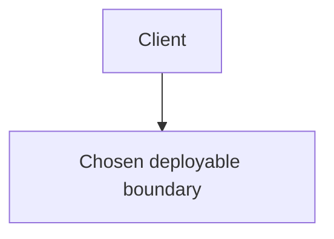

# ADR-[number]: [Decision title]

- **Status:** Proposed
- **Date:** [YYYY-MM-DD]

## Context and problem statement

[Describe the system, the decision to make, and the architectural drivers.]

## Requirements and evidence

### Confirmed requirements

- [Requirement]

### Constraints

- [Constraint]

### Assumptions

- [Assumption, clearly labeled]

### Open questions

- [Question that could change the decision]

## Options considered

### Option 1: [name]

[Structure, ownership, communication, data, flows, benefits, drawbacks, failure handling, and fit.]

### Option 2: [name]

[Structure, ownership, communication, data, flows, benefits, drawbacks, failure handling, and fit.]

### Option 3: [name]

[Structure, ownership, communication, data, flows, benefits, drawbacks, failure handling, and fit.]

## Comparison

| Criterion | Option 1 | Option 2 | Option 3 |
|---|---|---|---|
| Transaction and consistency model |  |  |  |
| Deployment and scaling |  |  |  |
| Failure isolation and recovery |  |  |  |
| Security and operations |  |  |  |
| Testing and maintainability |  |  |  |

## Decision

**Choose [option] [status: provisional/final/conditional].**

[State why this option follows from the evidence. State what it does not guarantee.]

### Component ownership

| Component | Owns and decides |
|---|---|
| [Component] | [Data and responsibilities] |

### Important operation flow

[Describe local transactions, external calls, pending/unknown/success/failure states, durable retries, and idempotency.]

## Security and identity

[Authentication, authorization, data protection, secrets, callback verification, audit, and explicit limits of the decision.]

## Diagram

[Explain why the diagram matches the decision. Do not imply independent deployment where it does not exist.]

## Consequences

### Positive

- [Benefit]

### Negative

- [Cost, risk, limitation, or operational consequence]

## Implementation implications

- [Durable processing, migrations, observability, testing, deployment, and integration implications.]

## Reconsideration conditions

- [Requirement, measurement, or organizational change that would cause a new decision.]
