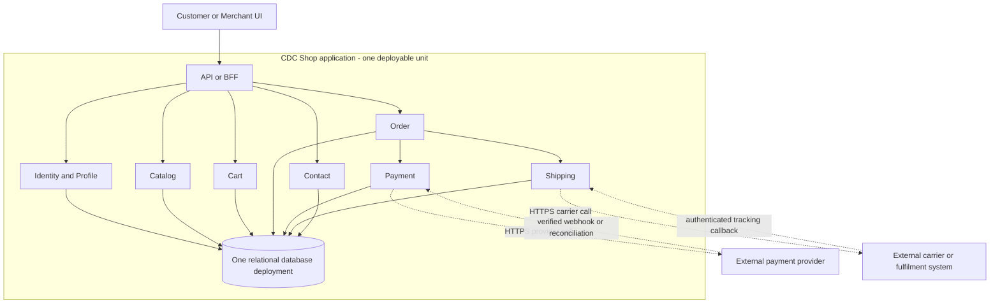

# ADR-001: CDC Shop architecture

- **Status:** Proposed
- **Date:** 2026-10-29

## Context and problem statement

CDC Shop is a system for a hardware-store catalogue, customer carts and orders, payment processing, and shipment/package information. It has two roles:

- **Customer:** register, log in, view a profile, browse/search/sort products, view details, manage a cart, pay, inspect an order/package, contact the shop, and log out.
- **Merchant:** log in, view a profile, browse/search/sort products, change prices, insert/remove products, and log out.

The requirements call the system “distributed” and mention management, payment, and shipment, but do not say whether CDC's internal components must be independently deployable. Payment execution and physical delivery may be provided by external systems. Traffic, availability, latency, compliance, stock, refunds, and carrier requirements are unspecified.

The architecture must preserve strong consistency for critical local operations such as creating an order with its agreed price, while allowing payment and shipment provider updates to be asynchronous. It must also be practical for a small team with limited deployment, monitoring, and troubleshooting capacity.

## Relevant requirements and constraints

### Confirmed requirements

- Customer and merchant authentication, profiles, and logout.
- Customer product listing, name search, price sorting, product details, cart operations, payment initiation, order/package information, About Us, and contact.
- Merchant product listing, name search, price sorting, details, price changes, insertion, and removal.
- Payment and shipment are part of the business domain.
- The system is described as distributed.

### Constraints and assumptions

- A small development team maintains the system.
- Payment and shipment execution may use external APIs; specific providers are not selected.
- CDC does not store card/payment details; a trusted payment provider handles them.
- Merchants have privileged product-management permissions enforced server-side.
- An order stores an immutable snapshot of product name, unit price, and quantity at checkout.
- Local order creation and price agreement require strong consistency. Payment and shipment status may temporarily lag.
- Product stock, quantity rules, addresses, refunds, cancellation, delivery guarantees, and operational targets remain open questions.

## Options considered

### Option 1: service-oriented layered application (modular monolith)

One deployable API/application contains cohesive modules for Identity/Profile, Catalog, Cart, Order, Payment, Shipping, and Contact. The modules expose typed interfaces and own logically separated tables/repositories within one relational database deployment; they do not imply one database per module. Payment and Shipping contain CDC's workflows and use provider/carrier adapters for external calls.

This is not independently deployable internal microservices. It is a pragmatic interpretation of “distributed” when distribution refers to the client and external integrations.

### Option 2: independently deployable microservices

Identity, Catalog, Cart, Order, Payment, Shipping, and Contact run as separate services with separate data ownership. Synchronous APIs handle queries/commands; a broker carries events. Checkout is a saga across services, with outbox/inbox processing, idempotency, retries, and eventual consistency.

This satisfies an interpretation that CDC's internal components must be distributed and independently deployable, but adds network, operational, and testing complexity.

### Option 3: event-driven serverless workflow

Managed identity, API endpoints, functions, queues/event bus, managed databases, and a durable workflow coordinate checkout, payment confirmation, shipment creation, retries, and contact delivery. Each function is short-lived and replay-safe; durable workflow state handles provider timeouts and long-running reconciliation.

This can provide elastic managed infrastructure, but may introduce cloud-provider coupling, function limits, eventual consistency, quota/cost concerns, and harder local testing depending on the selected platform.

## Compact comparison

| Criterion | Modular monolith | Microservices | Event-driven serverless |
|---|---|---|---|
| Local transaction simplicity | High | Low; saga required | Low; workflow/conditional writes required |
| Internal independent deployment | No | Yes | Yes, at function/workflow level |
| Operational burden | Usually lowest for this team | Usually higher because of service operations | Varies; platform operations are reduced but workflow/platform complexity remains |
| Failure/scaling isolation | Application/database boundary | Per service | Per function/managed component |
| Testing and debugging | Simplest | Distributed contract/integration testing | Cloud/workflow emulation and tracing |
| Portability | Relatively high | Moderate | Depends on managed-service choices; often lower |
| Fit for current small-team assumptions | Strong | Risk of overengineering | Depends on traffic and cloud constraints |

## Decision

**Choose Option 1, the service-oriented layered application (modular monolith), as the provisional architecture for CDC Shop.**

This is the chosen architecture for the current requirements and assumptions. It is not a claim that CDC's internal modules are independently deployable. If “distributed system” is later confirmed to require independently deployable internal services, this decision must be replaced with Option 2 rather than stretched to fit.

The modules have clear business ownership and private domain models:

| Component | Owns and decides |
|---|---|
| Identity/Profile | Credentials, roles, sessions, and profile data |
| Catalog | Products, current prices, search/sort results, and merchant product changes |
| Cart | Customer carts and cart items |
| Order | Orders, immutable line-item snapshots, order state, and customer order views |
| Payment | Payment attempts, provider references, idempotency keys, callbacks, and reconciliation |
| Shipping | Shipments, tracking/package states, carrier references, callbacks, and retries |
| Contact | Customer messages/tickets and support delivery |
| API/BFF | Authentication context, rate limits, DTO mapping, and routing; no business data |

The one database deployment contains logically separated tables (and, if useful, database schemas) with a designated owning module. “Ownership” means that only the owning module's repository/application interface may change those tables; it does not mean that each module has a separate database. Other modules use defined typed commands or queries and may consume selected events. They do not perform unrestricted direct table access, cross-module business writes, or business logic in ad-hoc joins.

Payment and shipment commands need durable processing. When a local state change must cause an external call, the module commits an outbox row or durable retry record in the same database transaction. A worker reads that record, calls the provider, records the result, and marks the record delivered. If the application stops, the record remains in the database and is picked up after restart; an in-memory background task alone is not sufficient. Idempotency keys make redelivery safe.

The decision favors reliable local transactions, maintainability, and testability for the stated small-team assumptions. Option 2 was rejected for now because its service discovery, network failure handling, data duplication, eventual consistency, and operational burden are not justified by any confirmed scale or team requirement. Option 3 was rejected for now because cloud coupling, function/workflow debugging, quotas, and cost uncertainty are not justified by any confirmed bursty workload or managed-cloud constraint.

## Main operation flows

### Browse and merchant catalogue management

The API authenticates the user and routes product queries to Catalog. Catalog validates search and sort parameters and uses indexed product queries. Merchant updates require a merchant role, validate the product and price, and use optimistic version checks. Catalog commits the current price; it does not rewrite existing order lines.

### Cart and checkout

Cart validates ownership and product references through the Catalog interface. At checkout, Order obtains current validated product data and writes the order and immutable product-name/price/quantity snapshots in a local transaction. A later merchant price change therefore cannot alter the order.

Order first commits the order snapshot and a pending payment attempt in one local transaction. Payment then calls the provider with a stable idempotency key. Only a confirmed successful provider result allows Order to transition to `PAID`. A timeout is represented as `UNKNOWN` or `PAYMENT_CONFIRMATION_PENDING`; Payment reconciles through a provider query, authenticated webhook, or bounded retry. If the application crashes after the provider succeeds but before the result is recorded, the durable payment attempt and idempotency key survive restart, and reconciliation discovers the result without charging again. A confirmed failure leaves the order unpaid and available for an explicitly controlled retry; an unknown result is never silently treated as failure or success.

After confirmed payment, Order is `PAID` and Shipping receives a durable request. If Shipping is unavailable, the order remains paid with shipment preparation pending and an operational retry/reconciliation record. Shipping retries using the same shipment idempotency key; the customer is not charged again. If shipment creation is ultimately rejected, the system requires an explicit business rule for refund, cancellation, or manual intervention; it must not invent one.

### Shipment tracking

Shipping stores the external shipment identifier and package state. Authenticated carrier callbacks update the shipment state machine. Customers read the latest known package status through the Order/Shipping query path; the system must not claim dispatch before dispatch is confirmed.

## Security and identity

Identity/Profile is the sole owner of credentials, sessions or token revocation, roles, and profile data. Passwords are stored only as strong password hashes; credentials and provider secrets are never exposed to Catalog, Cart, Order, or the client. The API/BFF authenticates each request and passes a verified user identity and role to the target module.

Authorization is enforced again in the application modules, not only in the UI or gateway. Customers may access only their own cart, profile, and orders. Merchants may change, insert, or remove products only when their server-side role permits it. Every sensitive operation validates resource ownership or merchant permission, and merchant changes are audited.

All client and provider communication uses encrypted transport. Payment card data is handled by the trusted payment provider, ideally through provider-hosted fields or tokens; CDC stores only provider references and state. Payment and carrier webhooks are authenticated, signature-checked, replay-protected, and idempotent. Rate limits, input validation, session expiration/revocation, secure secrets management, least-privilege database access, and security logging are required implementation controls.

## Mermaid overview

The diagram is consistent with the decision: the `CDC Shop application` subgraph is one deployable unit, its modules communicate internally, and one database deployment contains their logically separated data. Only the dashed calls cross a network boundary to external systems. The diagram does not imply that each module is independently deployed. If internal independent deployment is mandatory, this diagram must be replaced by a service-owned-data design.

## Consequences

### Positive

- Strong local transaction support for order creation and price snapshots.
- Lower deployment and operational complexity than microservices or serverless.
- Clear ownership enables maintainability, testing, and a future extraction path.
- Payment and shipment failures are explicit states rather than false atomicity.
- Provider-specific code is isolated behind adapters.
- Merchant authorization and customer resource ownership can be enforced centrally and consistently.
- A payment timeout or shipment outage has a visible, recoverable state rather than causing an accidental duplicate charge.

### Negative

- A process or database failure can affect multiple capabilities.
- Catalog, checkout, and merchant traffic cannot be scaled independently without later extraction.
- The shared database is a potential coupling and migration bottleneck.
- External payment/shipping operations still require retries, reconciliation, idempotency, and observability.
- This option may not satisfy a strict interpretation of internally distributed architecture.
- A shared process/database creates a broad failure domain and requires backups, recovery procedures, and capacity monitoring.
- A paid order can remain pending shipment until a provider or operational issue is resolved; customer support must be able to inspect and repair these states.

## Important implementation implications

- Use strong password hashing, encrypted transport, server-side RBAC and ownership checks, secure secrets, input validation, session controls, and authenticated/replay-protected webhooks. Audit merchant changes and never store payment card details in CDC.
- Use a local transaction for the order snapshot and pending payment attempt; use optimistic locking for merchant product updates and define checkout/stock concurrency rules.
- Use the durable outbox/retry mechanism described above. Make checkout, provider calls, callbacks, shipment creation, and event handling idempotent; persist correlation IDs.
- Represent validation, authentication, authorization, conflict, provider-unavailable, and payment-unknown errors explicitly.
- Use versioned migrations, backups, health checks, logs/metrics/traces, reconciliation jobs, and tests for transactions, adapters, duplicate requests, provider timeouts, and shipment retries.

## Assumptions and unresolved questions

### Assumptions

- External payment and carrier integrations provide suitable APIs, test environments, webhook mechanisms, and idempotency support, or CDC supplies equivalent safeguards. This is an integration assumption, not a confirmed provider capability.
- A relational database is acceptable for the initial deployment.
- Contact can be implemented as a stored message, email/helpdesk integration, or small support workflow.

### Open questions

- Does “distributed system” require independently deployable internal services?
- What are the product stock, quantity, address, tax/currency, refund, cancellation, and delivery requirements?
- What availability, latency, throughput, recovery, audit, privacy, and regulatory targets apply?
- Which payment provider and carrier will be used, and what are their webhook/idempotency guarantees?
- How long should carts, sessions, payment attempts, and shipment records remain available?

## Reconsideration conditions

Reconsider this decision in favor of microservices if independent internal deployment, team ownership, service-level scaling, or failure isolation becomes a confirmed requirement. Reconsider serverless if traffic is highly bursty, a managed-cloud strategy is accepted, and durable asynchronous workflows materially reduce operational cost. Reconsider the baseline if the shared database becomes a measured availability, throughput, or organizational bottleneck.
